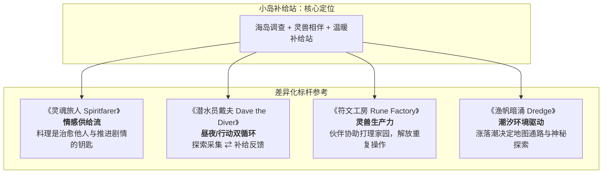

# 2026-11-03 · 种田流玩法深度剖析与《小岛补给站》玩法优化参考

> **归档日期**：2026-11-03  
> **适用项目**：[《小岛补给站》（Island Supply）](https://github.com/dragonge/island-supply)  
> **核心议题**：什么是“种田流”的底层驱动力？面对单人、手绘独立游戏开发边界，《小岛补给站》应当参考谁的玩法进行差异化优化？

---

## 一、 什么是“种田流”？底层心理与心流机制解构

“种田流”早已不仅指“在土地上挖坑播种”，而是一种**融合了农耕文化基因、高度心理安全感与确定性反馈的正向循环体验**。

### 1. 四大核心心理支柱

1. **确定性与无挫败的“安全岛”心理**
   - 现代竞技或高难度游戏充满不确定性与即时挫败感（如死亡惩罚、排位掉分）。
   - 种田流提供**绝对确定、不可逆剥夺的正向反馈**：播种必有发芽，浇水必有收获，时间是玩家最坚实的盟友。这种“只要投入时间就一定变好”的机制，为玩家提供了极强的情绪按摩。
2. **空间重建与秩序感建立**
   - 开荒从杂草丛生、荒废残垣开始。玩家通过一砖一瓦、一步一行的打理，将“混乱荒芜的自然”改造为“整洁、生机、可控的家园”。
   - 这种掌控力满足了人类本能中对“建立领地与庇护所”的渴望。
3. **生产力跃迁与自动化爽感（从劳役到解放）**
   - **初期**：体力受限，纯靠双手双脚，充满微操疲劳；
   - **中期**：升级农具、烹饪体力料理、制造初级灌溉或加工设施；
   - **后期**：自动化喷灌、驯化伙伴协助打理、流水线初现，玩家从“体力劳动者”晋升为“庄园主/探险家”，获得战胜繁琐的解放感。
4. **情感投射与生活容器**
   - 种出来的作物不仅是数值资产，更是**社交与情感的货币**。送给心仪的岛民、喂食身边的灵兽幼崽、招待靠岸避风的疲惫水手。
   - 经营成果一旦与生命、陪伴和故事产生化学反应，游戏就具有了温度。

---

### 2. 现代种田游戏的四大演化形态

| 类别 | 代表作 | 核心心流机制 | 对独立团队的挑战 |
|---|---|---|---|
| **传统田园生活型** | 《牧场物语》、《星露谷物语》 | 大规模农庄 + 四季轮作 + 繁杂城镇人际恋爱 + 深度矿洞 | **体量极大**，美术与对话量爆炸，容易做成平庸低配版 |
| **生存建造/工业流水线型** | 《饥荒》、《缺氧》、《幸福工厂》 | 资源枯竭压力 + 物理/化学逻辑自动化 + 极限生存 | 重逻辑底层与工程实现，偏硬核，缺乏温情叙事 |
| **冒险驱动型（RPG种田）** | 《符文工房》、《波西亚时光》 | 种田为了做药做装备下迷宫，迷宫掉落稀有种子和素材反哺农场 | 战斗系统与数值深度要求高 |
| **叙事治愈微种田（Cozy Narrative）** | 《灵魂旅人》、《潜水员戴夫》、《渔帆暗涌》 | 轻度耕作/补给作为探险与剧情的锚点，重情感羁绊与独特氛围 | **最适合独立精品**：体量可控、差异化鲜明、记忆点深刻 |

---

## 二、 《小岛补给站》（Island Supply）当前玩法诊断

针对当前版本（v0.6《未寄出的归航信》）与《海岛剧情与灵兽伙伴设计草案》，项目的现状与矛盾点如下：

### 1. 优势与不可替代的基石
- **独特的手绘孤岛调性**：低饱和度美术、远离喧嚣的海岛与灯塔意象，氛围天然具备治愈感。
- **扎实的时间与日历基础**：v0.6 已实现归潮历、24小时时钟、时段、潮汐状态显示及证据时间戳，为后续环境联动奠定了坚实底层。
- **有深度的调查叙事主线**：林遥三年前的失联真相、守卫的交接规程、信标解谜，具备优秀的文字与悬疑底色。

### 2. 当前割裂与瓶颈
- **种田沦为打怪的“血瓶生成器”**：萝卜、浆果、小麦烹饪成蔬汤，目前主要为了回复体力和血量。若种田只是探险的“手续”，玩家很快会感到繁琐。
- **“补给站”缺失供给对象**：游戏名为《小岛补给站》，但在既有流程中，除了阿岚和玩家自己，缺乏真正需要补给的外部访客或动态系统。
- **潮汐机制尚未可玩化**：潮汐目前仅作为界面文字与状态显示，尚未与地图通路、生态采集产生物理层面的强关联。

---

## 三、 本项目应参考谁的玩法进行优化？

避免盲目对标《星露谷物语》的大而全，聚焦以下四款在特定机制上极度契合的标杆：



### 1. 参考标杆一：《灵魂旅人》（Spiritfarer）
- **核心借鉴点**：**将“种植与烹饪”打造成“情感传递与剧情触发”的唯一货币**。
- **具体落地机制**：
  - **为远航者提供一碗热汤**：灯塔修复后，过往船只、海上信使或海鸥信差会短暂停靠。
  - **专属补给需求**：某位疲惫水手只想要一碗带焦香的小麦粥；满足他后，他会留下外港的报纸（新线索）、未见过的远洋种子或珍稀零件。
  - **告别纯数值驱动**：玩家种田不再是因为“我缺血药”，而是“今天有一艘新船停靠，我想做一顿好饭招待他们”。

### 2. 参考标杆二：《潜水员戴夫》（Dave the Diver）
- **核心借鉴点**：**“日间探索采集 ⇄ 傍晚/归家供给结算”的极简双重循环**。
- **具体落地机制**：
  - 白天玩家探索林地、潮汐湾、遗迹，采集岛上的野生菌、贝类与机关零件。
  - 傍晚返回家园，打理农田、点亮厨房、完成当日补给箱。
  - 第二天清晨 06:00 醒来，在投递管或码头收取“回信”与“报酬”，形成节奏明快的单日心流。

### 3. 参考标杆三：《符文工房》（Rune Factory）
- **核心借鉴点**：**灵兽不仅是宠物，更是贴心的家园伙伴与劳动力**。
- **具体落地机制（呼应草案）**：
  - **切忌铺量，做透第一只伙伴**：优先做出第一只具有强互动感的灵兽（如海獭、灵鸥）。
  - **信任闭环**：发现受伤/饥饿的野生灵兽 ➔ 投喂它喜爱的特定农作物/料理 ➔ 获得信任，住进小院 ➔ **灵兽每天早晨自动帮浇灌已开垦的土地，或在低潮时在海湾捡拾海产**。
  - 结果：玩家既体验到了温馨的陪伴感，又被自然解放了浇水等机械劳动，能全心投入后续海怪与遗迹探险。

### 4. 参考标杆四：《渔帆暗涌》（Dredge）
- **核心借鉴点**：**潮汐与时间作为“天然的关卡机关”**。
- **具体落地机制**：
  - **动态通路（Tidal Paths）**：
    - **退潮期（Low Tide）**：潮汐湾露出深处的暗礁与沉船残骸，玩家可以走过去调查被水淹没的古旧信筒与石碑；潮间带可采集独特食材。
    - **涨潮期（High Tide）**：海水漫过通路，深处隔断，但近海可以钓鱼或打捞漂浮物资。
  - 配合现有的“归潮历时段预报”，玩家必须规划一天的行程：“趁着下午是低潮，我必须在 15:00 前赶到潮汐湾，天黑涨潮前返回”。

---

## 四、 落地路线图与开发优先级建议

```
Phase 1: 机制闭环（低成本、高回报）
├── 码头/投递管「补给委托信箱」：每天刷新 1~2 个外部补给需求，换取特殊报酬
└── 潮汐地形实体化：让潮汐湾关键通路在低潮时通行、高潮时阻断

Phase 2: 灵兽伙伴与劳力解放
├── 第一只灵兽的相遇与喂养支线（结合草案）
└── 灵兽驻留家园：解锁自动化浇水/拾荒功能

Phase 3: 深度叙事与第二章演进
├── 补给站接待系统：引入外港商船、漂流遇险者
└── 海怪调查第二章：通过海产料理与特殊香料平息海兽动向
```

---

## 五、 本日灵感总结一句话

> **《小岛补给站》不需要做成浩瀚繁琐的种田大厂，它的灵魂在于“灯塔下的守望与烟火气”——让农田生出的作物、厨房炖出的热汤，成为连接迷途船只、抚慰灵兽伙伴与拼凑海岛记忆的温柔锁钥。**
