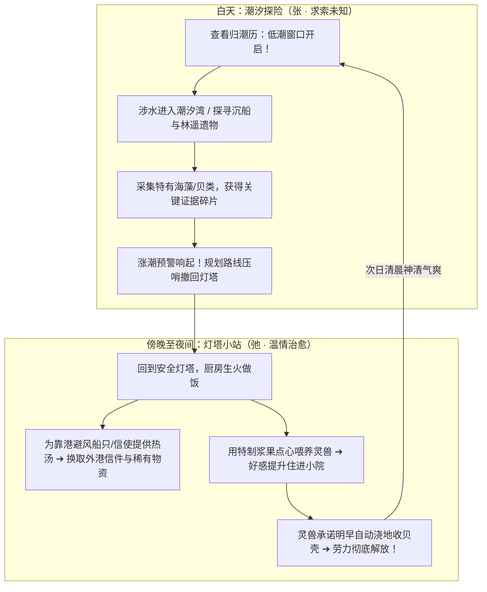

# 2026-11-03 15:33 · 核心玩法确立：《小岛补给站》潮汐探险与温情供给双螺旋闭环

> **归档时间**：2026-11-03 15:33:00  
> **适用项目**：[《小岛补给站》（Island Supply）](https://github.com/dragonge/island-supply)  
> **核心决策**：正式确立游戏底层玩法模型为——**【潮汐涨落为节律的涉水探险（主骨架）】＋【傍晚归航补给与灵兽抚育（内循环）】**，拒绝泛滥的数值滚雪球与硬核刷怪，走“小而美、重氛围、强张弛”的独立精品路线。

---

## 一、 核心玩法定义与设计公式

```
【核心玩法公式】
核心主骨架（张·求索）：以潮汐涨落为天然环境节律的涉水探险（参考《星际拓荒》＋《渔帆暗涌》）
          ＋
家园内循环（弛·治愈）：傍晚归航灯塔小站，做热饭供给出海船只与抚育灵兽（参考《灵魂旅人》＋《潜水员戴夫》＋《符文工房》）
```

这款游戏的灵魂不是“把地种大、把数值刷高”，而是：  
**「在大海潮汐的呼吸中奔赴未知探寻真相，在灯塔升起的炊烟里抚慰归人与生灵。」**

---

## 二、 玩法机制血统拆解与设计机理

### 1. 主骨架：潮汐节律涉水探险（参考标杆：《星际拓荒》＋《渔帆暗涌》）

* **机制原型**：
  * **《星际拓荒》（Outer Wilds）**的“沙漏双星”流沙机制：流沙带走露出地下遗迹，流沙灌入封死通道，时间是动态地形的物理开关。
  * **《渔帆暗涌》（Dredge）**的“昼夜与安全感拉扯”：出海探险必须时刻关注时钟，在贪婪搜集与安全归航之间做取舍。
* **在《小岛补给站》中的落地设计**：
  * **退潮期（低潮 Low Tide，窗口期约 4~6 游戏小时）**：
    * 海水退去，潮汐湾深处露出一道湿漉漉的石阶栈道与沉船残骸；
    * 只有此时，玩家才能涉水走进原本无法到达的“沉水信标台”和“旧信投递暗口”，获取关于林遥与三年前风暴的关键证物；
    * 潮间带浅滩浮现大量特有海藻、甲壳与贝类。
  * **涨潮预警与涨潮期（高潮 High Tide）**：
    * 界面提示潮水上涨，海水开始漫过栈道；
    * 玩家必须做出决断并压哨撤回灯塔高地，若被海水封路则面临受困与体力流失；
    * 高潮期近海变成深水区，水生鱼群游动，可在岸边打捞漂浮物资。
* **为什么好玩**：
  * **不靠无脑堆怪制造难度**，大自然的节律（潮汐时钟）本身就是最引人入胜的天然关卡与解谜机制。

---

### 2. 内循环：温情供给与灵兽抚育（参考标杆：《灵魂旅人》＋《潜水员戴夫》＋《符文工房》）

* **机制原型**：
  * **《灵魂旅人》（Spiritfarer）**的“情感货币机制”：做饭不为卖钱，而是满足特定角色的个性化需求。端上一碗热汤，换取对方的真心、身世线索与新海图。
  * **《潜水员戴夫》（Dave the Diver）**的“张弛闭环”：白天冒险采集的原料，傍晚/夜晚立刻转化为可服务的料理，产生即时正面反馈。
  * **《符文工房》（Rune Factory）**的“灵兽家园协助”：救助野外生灵，投喂喜爱食物，灵兽定居后主动帮分担浇水、拾荒等繁琐家务，实现生产力解放。
* **在《小岛补给站》中的落地设计**：
  * **日落归航的烟火气**：
    * 涨潮封路后，外部探索告一段落。玩家回到安全明亮的灯塔家园，厨房升起炊烟；
    * 白天采集的野菌、海藻、收获的萝卜小麦在此刻烹饪成冒着热气的浓汤。
  * **“补给站”核心服务落地**：
    * 码头停靠避风小船或信使信筒刷新需求：“外港巡逻艇遭遇暗流，急需 2 份热麦汤”；
    * 玩家交付料理，换取林遥在外港的消息信件、未见过的远洋作物种子、或灯塔修缮关键零件；
  * **灵兽伙伴的抚育与劳力解放**：
    * 在潮间带救助受伤小灵兽，用特制点心投喂，建立信任；
    * 灵兽好感提升后留在小院。每天早晨 06:00 它会替玩家浇灌农田，并在退潮时替玩家去浅滩拾取贝壳。
    * **玩家从重复劳动中彻底解脱，带着温暖陪伴奔赴新一轮低潮！**

---

## 三、 黄金双螺旋心流图



---

## 四、 本项目后续开发的系统落地准则（开发红线与指导）

后续所有系统开发必须严格对标这一闭环，不符合该闭环的系统坚决砍掉：

| 模块 | 传统泛滥做法（坚决不做 ❌） | 本项目确立标准（坚决落实 ✔️） |
|---|---|---|
| **种田** | 几十块农田网格、几十种作物、纯卖钱滚雪球 | 固定几块精炼田地，作物专供“做热饭补给他人/喂灵兽” |
| **料理** | 纯粹的打怪回血药水、数值 Buff | “补给站交付物”与“灵兽好感道具”，每一道菜都是剧情钥匙 |
| **潮汐** | 仅作为 UI 文字提示和看客数据 | **真实影响地图通行**：低潮露路深入，高潮淹没封路 |
| **灵兽** | 纯打怪跟班或纯观赏摆件 | 拥有性格与喜好，住进家园后**自动接管浇水/拾荒** |
| **主线** | 刷怪打 Boss 拯救世界 | 查清林遥三年前留下的真相，修好灯塔照亮远航 |

---

## 五、 一句话总结

> **白天看准潮汐涉险夺宝，夜晚守着灯塔热汤温情。**  
> 《小岛补给站》的成功之路在于极致的张弛有度——把“潮汐”做成最具悬念的探险时钟，把“食物”做成最具温情的情感锁钥。
