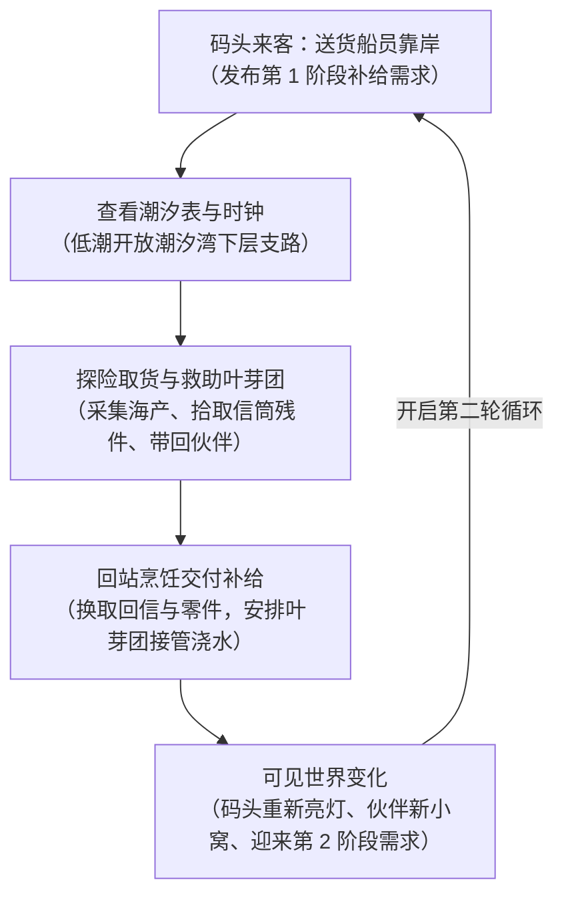

# 2026-11-03 16:05 · 设计审阅纠偏与 30–45 分钟试玩切片落地方案

> **归档时间**：2026-11-03 16:05:00  
> **适用项目**：[《小岛补给站：归潮信标》（Island Supply: Beacons of the Tide）](https://github.com/dragonge/island-supply)  
> **核心决策**：**收敛战线，分阶段交付**。暂停无序扩充多岛与硬核生存，海难求生与造船外岛保留为后续蓝图。当前下一阶段目标严格锁定为：**目标 30–45 分钟、能完整跑通两轮循环的最小可行性切片（MVP）**。

---

## 一、 关键冲突与审阅纠偏决议

### 1. 补给委托：坚决不让每一道菜都变成“卡剧情的钥匙”
* **纠偏前问题**：若所有推进都强制要求交菜，会演变成恶性卡脖子（“想看下一段剧情，先交两碗汤”）。
* **纠偏后规则**：明确将料理分流为四种职能，料理主要作为正向激励而非强制卡点：
  1. **日常船员招待**：常规补给委托，换取种子、基础建材与零星外港情报；
  2. **伙伴喜好**：投喂提升亲密度，解锁专属小剧场与互动动作；
  3. **探险行囊**：自用，提供体温防寒、防疲劳与移速增益；
  4. **关键剧情道具**：仅在极关键转折（如全篇 1~2 次特定安抚节点）使用定制料理。

### 2. 潮汐机制：从“死板昼夜绑定”改为“按潮出发，归航补给”
* **纠偏前问题**：
  * 原文档将关键主线死锁在低潮，且试图绑定“白天探险、傍晚经营”。但游戏内低潮为 06:00–09:00 与 18:00–21:00，夜间同样是低潮窗口；
  * 现实 1 秒＝岛内 1 分钟，3 小时低潮实际只有 3 分钟有效操作时间，强行设卡与严苛惩罚会导致挫败感极强。
* **纠偏后规则**：
  * **主线保底通路全天可走**（高岸路线）；
  * **低潮提供捷径、水下古遗迹支路与额外稀有收获**；
  * **提供“营地等待到下一次低潮”功能**，避免垃圾等待时间；
  * 涨潮时保留已解谜进度，水淹时将角色安全推回最近的安全高地或撤离点，绝不直接扣死体力或把玩家卡进水里。

### 3. 灵兽减负：与现有成熟节奏（40~80秒）自洽
* **纠偏前问题**：现有代码中作物浇水后 40/60/80 秒即成熟，阿岚已支持每日帮助；设定“灵兽每天 06:00 浇一次”极易踏空且与阿岚功能重叠。
* **纠偏后规则**：
  * **首发伙伴锁定为草案原案：【叶芽团】（`pet_leaf`）**，避免同时制作两套美术资产；
  * **劳力机制**：改为**“玩家安排后，叶芽团自动处理下一批符合条件的已播种农田”**；
  * 基础帮忙不必等好感满值即可体验（降低门槛）；高好感用于解锁营地小故事与信物互动（如推湿木扣）。

### 4. 严谨性纠正：删除不科学求生内容，聚焦海岛真实规律与虚构生态
* **必须更正的项**：
  1. **彻底删除“篝火木炭粉灌服解毒”**：普通木炭不能等同医用活性炭，专业毒物控制中心（Poison Control）严禁自行用普通炭粉洗胃；
  2. **彻底删除“闻/皮试/唇试/舌尝测毒法”**：尤其对野生蘑菇，味道、气味和局部接触完全无法鉴别鹅膏毒肽等致命毒素（加州公共卫生部门警示）；
  3. **纠正离岸流概念**：不简化为单一“白沫带”，真实离岸流常表现为平静无浪间隙、向外移动的泡沫或混浊水流；
* **手记定位修正**：手记重点记录**“归潮岛虚构动植物习性、岛屿潮汐水文观测规律、以及老一辈守灯人的航海生活经验”**，严肃对待现实科学与科普信誉。

---

## 二、 当前首发切片目标：30–45 分钟可玩原型（MVP）

不铺大洋群岛，在现有家园与潮汐湾地图基础上，做透以下 **4 大最小闭环**（支持重复游玩 2 轮）：

### 1. 潮汐湾可玩支路与安全机制
* 潮汐湾增加一条随潮汐升降的**下层浅滩支路**；
* 低潮（06:00–09:00 / 18:00–21:00）时栈桥露水可通行，连接一处退潮暗洞与贝壳富集区；
* 涨潮时水面上涨阻断，若角色在低地，弹出提示并在淡出后安全安置在高地路口；
* 休息或营地交互中加入**“等待至下一次退潮”**选项。

### 2. 有名有姓的补给来客（两次关联委托）
* 引入送货艇船员**莫恩（Morn）**短暂停靠码头：
  * **第一次委托**：船舱受潮，需要 2 份热麦汤暖身。交付后获得外港蔬菜种子与一张旧维护草图；
  * **第二次委托（转天或下一轮）**：准备返航，需要干粮补给。交付后协助修好码头旧缆桩，并带来外港关于林遥的最新传言。

### 3. 首只伙伴【叶芽团】正式落地
* **相遇**：在旧营地或潮汐湾支路避雨处相遇，交付基础蔬食建立信任；
* **协助**：在院内设立伙伴停留点，互动安排工作：叶芽团会在玩家播种后，自动将水分补满；
* **反馈**：阿岚触发新对白，回忆起当年师父与叶芽团的往事，营地多出一张小垫子。

### 4. 阶段性终点与可见变化
* 完成两轮委托后：
  * **码头系缆桩挂灯重新点亮**；
  * **叶芽团在守林屋门前推来那枚留有温度的旧木扣**；
  * **收到第一封正式的外港信件**，引出第二章海怪与深海声标的悬念。

---

## 三、 试玩验证验收标准（4 问自检）

下一阶段代码与场景实装后，以此四条作为唯一交付验收标准：
1. **玩家出门前，能否清晰说出“我这一趟出门是为了什么”？**（找低潮食材、还是核对时间）
2. **玩家归家时，是否有明确的期待？**（收菜、做饭交货、看伙伴）
3. **叶芽团的自动化，是否真实让玩家感受到了减负，而不是添乱？**
4. **两轮跑完后，玩家是否愿意再来一轮？**
