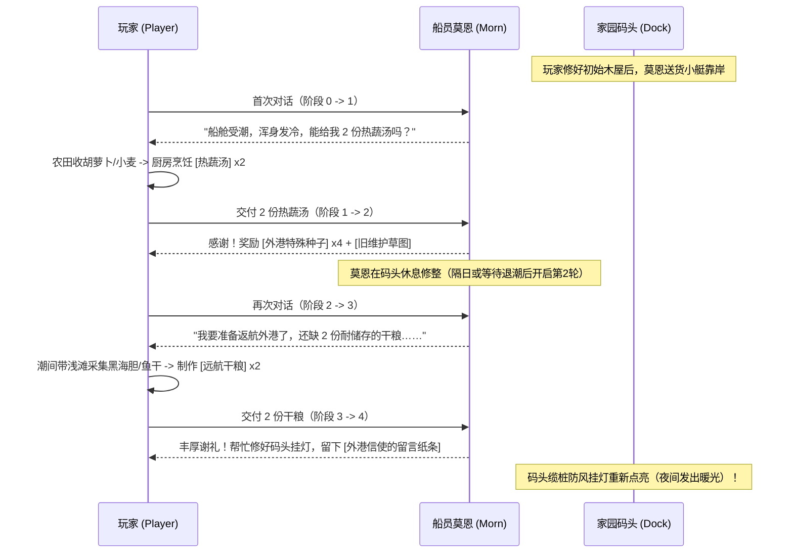

# 2026-11-03 16:09 · 《小岛补给站：归潮信标》MVP 首发切片详细技术与流程规格书

> **归档时间**：2026-11-03 16:09:00  
> **适用项目**：[《小岛补给站：归潮信标》（Island Supply: Beacons of the Tide）](https://github.com/dragonge/island-supply)  
> **文档属性**：**代码实装前置技术规格书（Spec-Driven Development）**。定义 30–45 分钟可玩切片的状态机、地图物理区域、交互判定时序、数值与新增文本 ID。

---

## 模块一：潮汐湾下层支路与等待机制（Tidal Path & Wait）

### 1. 潮汐状态机与时间判定（复用 `island_calendar.gd`）
* **低潮有效窗口**：`06:00 – 09:00`（早潮）与 `18:00 – 21:00`（晚潮）。
* **判定逻辑**：`IslandCalendar.is_low_tide(minute_of_day)` 返回 `true` 时，支路为露出可通行状态；其余时间（涨潮/高潮）为深水阻断状态。

### 2. 地图物理与位置规范（`world.gd` & `world_renderer.gd`）
* **场景位置**：潮汐湾（`cove`）地图南部浅滩区。
  * **高岸安全主干道**：全天可通行，Y 坐标 $\le 420$；
  * **下层潮汐浅滩支路**：Y 坐标在 $[430, 560]$，X 坐标在 $[200, 650]$；
  * **水下暗洞与特产点**：浅滩东南角（坐标约 `Vector2(600, 520)`），刷新 3 个**【潮间带黑海胆/海星】**采集点；
* **涨潮安全回退保护（Anti-Stuck Mechanism）**：
  * **涨潮预警**：在 08:30 和 20:30 时，屏幕右下角弹出黄色小提示：`“海水正在上涨，请注意潮水……”`；
  * **退回机制**：当时间到达 09:00 或 21:00（进入涨潮），如果玩家判定仍在下层支路（$Y > 420$），屏幕轻微淡出 0.5 秒，将玩家坐标平滑重置回安全高地路口 `Vector2(320, 380)`，弹出提示：`“潮水漫过了浅滩，你退回了安全的高岸。”`（不扣血、不惩罚、保留全部拾取物）。

### 3. 营地“打盹等待”功能（Camp Wait）
* **入口**：在主屋床铺或户外长凳按 E 互动，菜单新增选项：
  1. `睡觉到次日 06:00`（原功能，跨日结算农田与资源）；
  2. `在此打盹，等待下一次退潮` **（新增功能）**；
* **等待算法**：
  * 如果当前时间在 09:00–18:00，时间快进至当日 **18:00**（晚低潮）；
  * 如果当前时间在 21:00–06:00，时间快进至次日 **06:00**（早低潮）；
  * 农田按消耗的分数自然推进水分与成长（不强制触发整日大刷新），消除玩家死等垃圾时间。

---

## 模块二：码头船员莫恩的两轮委托（Morn's Supply Requests）

### 1. 状态机设计（`state.gd`）
在全局存档状态中新增字段：
```gdscript
var morn_quest_stage: int = 0  # 0: 未触发, 1: 接下第1轮, 2: 完成第1轮, 3: 接下第2轮, 4: 全部完成
```

### 2. 两轮流程与交互时序



---

## 模块三：首发灵兽【叶芽团】（`pet_leaf`）落地

### 1. 相遇与救助（Rescue Event）
* **相遇地点**：林地旧营地避风木桌旁（坐标与草案一致）。
* **触发条件**：
  * 在旧营地桌上发现一只缩成一团的小生灵【叶芽团】（类似背上长着嫩叶的胖胖小精灵）；
  * 它并非野生敌怪，头顶冒出微弱的饥饿图标；
  * 玩家身上持有任意 1 份蔬菜（如萝卜）或浆果，按 E 递上食物；
  * 触发专属过场：小家伙吃下食物，轻轻蹭了蹭主角的手，阿岚触发新感叹台词：`“它又回来了……当年师父还在的时候，它最喜欢趴在门槛上。”`

### 2. 伙伴状态机与减负打理逻辑（`state.gd`）
```gdscript
var pet_leaf_rescued: bool = false       # 是否已救助
var pet_leaf_assigned_work: bool = true   # 是否安排家园协助（默认开启）
```
* **解决 40~80 秒成熟周期的防冲突方案**：
  * **不采用死板的“每天06:00浇一次”**（因为玩家可能06:00还没种）；
  * **采用事件响应型自动化**：
    * 当 `pet_leaf_rescued == true` 且 `pet_leaf_assigned_work == true` 时；
    * 只要玩家在田里播种下种子（或者自然成熟收获后重新播种），叶芽团会在 **3 秒内迈着小碎步跑过去，把刚播下的干涸农田自动浇满水**！
    * **玩家真实体验**：玩家只管播种和收割，繁琐的“按E倒水/浇灌”完全被伙伴接管，爽感立竿见影！
* **情感交互**：
  * 玩家回到家园时，按 E 可以抚摸叶芽团；
  * 好感提升后，叶芽团会在门前推来那枚留有余温的**【湿木扣】**（重要剧情信物）。

---

## 模块四：家园可见世界变化与存档升级（v2 ➔ v3）

### 1. 视觉里程碑清单
* **里程碑 A（码头复苏）**：当莫恩第 2 轮委托完成后，码头木桩上熄灭了三年的【铜质防风挂灯】重新亮起暖黄光芒，入夜后照亮海面；
* **里程碑 B（伙伴小窝）**：守林木屋门廊下，多出一张铺着干草与贝壳的精美【叶芽团小草垫】；
* **里程碑 C（第一封外港回信）**：码头信箱上插着一封带邮戳的防水信筒，日志中解锁新调查线索：`【外港回音：白鹭号的平安录音】`。

### 2. 存档迁移兼容策略（v2 ➔ v3）
* 存档版本号由 `2` 升至 `3`；
* 读入 v2 旧档时，新增字段自动填充默认缺省值（`morn_quest_stage = 0`, `pet_leaf_rescued = false`），确保老存档玩家直接继续玩新内容，绝不坏档。

---

## 模块五：文本 ID 清单预案（`localization/game.csv` 新增项）

| 文本 ID | 简体中文（zh_CN） | 英文（en_US） | 用途 |
|---|---|---|---|
| `TIDE_WARN_RISING` | 海水正在上涨，浅滩即将被淹没…… | The tide is rising; the shallows will soon flood... | 潮水预警 |
| `TIDE_RETREAT_SAFE` | 潮水漫过了浅滩，你退回了安全的高岸。 | The tide covered the path. You retreated safely to high ground. | 安全回退 |
| `UI_CAMP_WAIT_TIDE` | 打盹等待下一次退潮 | Rest until the next low tide | 营地菜单 |
| `NPC_MORN_NAME` | 船员 莫恩 | Sailor Morn | NPC 名字 |
| `MORN_QUEST_01_DESC` | 莫恩浑身发冷，需要 2 碗热蔬汤暖身。 | Morn is shivering and needs 2 bowls of hot vegetable soup. | 任务日志 |
| `MORN_DIALOGUE_01` | 呼……这海风简直要把人冻透了。朋友，能匀我两碗热汤吗？ | Brrr... this sea wind freezes to the bone. Friend, can you spare two bowls of hot soup? | 对白 |
| `MORN_DIALOGUE_01_THANKS` | 肚子里总算暖和过来了！这是外港带过来的种子和旧草图，留给你！ | Finally warm inside! Take these outer-port seeds and old sketches, you'll need them! | 交付完成 |
| `MORN_QUEST_02_DESC` | 莫恩准备返航，需要 2 份耐存放的干粮。 | Morn is preparing to sail back and needs 2 rations of dry food. | 任务日志 |
| `MORN_DIALOGUE_02_THANKS` | 够仗义！我顺手把你们码头的缆桩灯修好了，夜里亮堂多了！ | You're a true friend! I fixed your dock lantern; it'll shine bright at night! | 交付完成 |
| `PET_LEAF_NAME` | 叶芽团 | Leafpuff | 伙伴名字 |
| `PET_LEAF_RESCUE_LOG` | 在旧营地救助了一只长着嫩叶的胆小小生灵。 | Rescued a timid little creature with green leaves at the old camp. | 伙伴日志 |
| `PET_LEAF_ACTION_WATER` | 叶芽团迈着小碎步，替新播种的农田浇好了水！ | Leafpuff trotted over and watered the freshly sown field! | 浮动提示 |
| `DOCK_LANTERN_INSPECT` | 码头的防风挂灯重新亮起来了，在黑夜里为归航者指引方向。 | The dock lantern is glowing again, guiding returnees through the dark. | 物体互动 |
