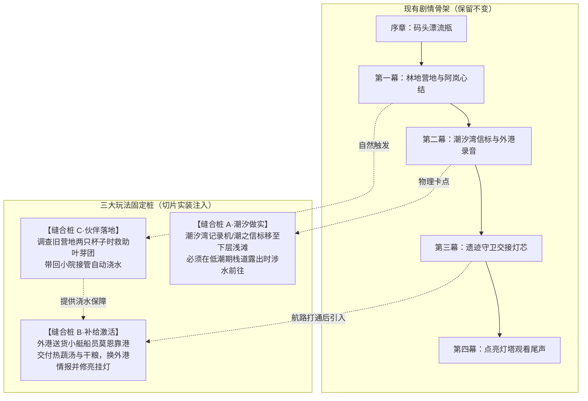

# 2026-11-03 16:15 · 现有剧情流程诊断与定位缝合闭环方案

> **归档时间**：2026-11-03 16:15:00  
> **适用项目**：[《小岛补给站：归潮信标》（Island Supply: Beacons of the Tide）](https://github.com/dragonge/island-supply)  
> **核心议题**：现有剧情流程现状全解；与核心定位的 3 处关键脱节诊断；在不推翻既有剧本的前提下，打入“三大玩法固定桩”实现玩法与叙事的完美缝合闭环。

---

## 一、 现有已实装剧情流程全拆解（v0.4 ~ v0.6 现状）

当前代码中内置的是一段约 **30~45 分钟的单线调查短篇《未寄出的归航信》**：

1. **开场（序章：旧信）**：
   * 旁白交代：“风暴把你的船推上了归潮小岛”；
   * 第二天码头石缝出现封蜡漂流瓶，信件落款是三年前阿岚失踪的师父林遥。
2. **第一幕（林中旧事与藏起的牌）**：
   * 调查林地西侧旧营地（桌上摆着两只杯子、包扎布）与北侧手记；
   * 发现当年灯塔是林遥**主动熄灭**的，手记留下了三座信标口诀；
   * 回家找阿岚，阿岚坦白因害怕确认师父遇难而藏起引航牌；玩家选择陪伴或求证，阿岚交出引航牌，解锁潮汐湾。
3. **第二幕（潮汐湾信标与外港回信）**：
   * 前往潮汐湾，按“岸、潮、星”顺序触碰三座信标解开机关；
   * 走到北侧记录机前听到外港回信录音——**真相大白：林遥三年前为避免船只触礁而关主灯引导白鹭号十七人避险前往外港，十七人全活，林遥留在外港修路；求援瓶只是卡在投递管里近期退潮脱落**。
4. **第三幕与第四幕（守卫交接与灯塔回应）**：
   * 遗迹读壁文，与守卫和平交接或战斗试炼，拿到备用灯芯；
   * 家园控制台选择“守灯”或“准备远航”，点亮灯塔，看尾声。

---

## 二、 现状与定位的偏差诊断：3 处严重脱节

现有故事的情感底色（守灯人的牺牲、阿岚的心结、归航的期盼）非常优秀，但**系统机制完全没有参与叙事，导致玩法与定位严重断层**：

| 脱节维度 | 当前 v0.6 现状（痛点） | 我们确立的核心定位（目标） | 造成的负面体验 |
|---|---|---|---|
| **补给系统** | 种田烹饪主要用于自己回血或可选给阿岚一碗汤；没有任何外部船只靠港。 | **温情供给流**：外来船只/信使靠岸，交付热食换取外港线索与建设材料。 | **“补给站”有名无实**，玩家感觉自己只是个纯跑图读信的独行侠。 |
| **潮汐系统** | 潮汐湾三座信标全天随时能按，潮汐涨落只是 UI 上的时间数字。 | **潮汐物理开关**：低潮露路深入夺宝，涨潮水淹回撤，决定探险窗口。 | **潮汐机制沦为纯看客背景板**，时间系统没有玩法压迫感。 |
| **伙伴系统** | 林地旧营地虽然写了“桌上摆着两只杯子”，但草案中的叶芽团完全未实装。 | **灵兽劳力减负**：救助叶芽团带回小院，自动接管已播种农田浇水。 | 重复手动作物浇水疲劳，缺少家园陪伴与温度。 |

---

## 三、 三大精准缝合固定桩（不推翻剧本，让系统参与叙事）

我们坚决不重写优秀的旧信真相剧本，而是**在既有骨架上打入 3 根玩法固定桩**，将种植、潮汐与灵兽无缝焊接入主线中：



### 1. 缝合桩 A（潮汐做实）：让潮汐成为推进主线的物理钥匙
* **改动点**：将潮汐湾中的**“潮之信标”或记录机暗洞**移至下层浅滩区；
* **效果**：玩家必须观察归潮历，趁着 **06:00–09:00 或 18:00–21:00 低潮栈道浮出**时涉水过去听录音；营地长凳增加“打盹等待退潮”。
* **价值**：潮汐机制从“文本摆设”瞬间升级为“核心探险节律”。

### 2. 缝合桩 B（补给激活）：让种植烹饪成为推动世界改变的抓手
* **改动点**：在第二幕与第三幕交界处（航路刚刚有起色时），码头停靠送货船员**莫恩（Morn）**；
* **两轮委托**：
  * 第 1 轮：受潮求热蔬汤 ➔ 奖励外港种子与草图；
  * 第 2 轮：返航求干粮 ➔ 帮忙修好码头防风挂灯，送来第一封外港回信！
* **价值**：补给站彻底名副其实，种田烹饪有了崇高的服务目标。

### 3. 缝合桩 C（伙伴落地）：让营地伏笔化为真实的陪伴减负
* **改动点**：调查旧营地桌上“两只杯子”时，触发伏笔暗线——救助蜷缩在桌边受冻的**【叶芽团】**；
* **效果**：带回小院入驻草垫，开启“播种后自动浇水”机制，解决作物 40~80 秒成熟期的繁琐操作；阿岚触发怀念旧师徒温情对白。
* **价值**：伏笔回收，情感升温，生产力飞跃。

---

## 四、 缝合后的 30–45 分钟完整循环心流

```
【出门有目标】看准低潮窗口 ➔ 涉水取证 / 救助叶芽团
      ↓
【归家有期待】带回食材海产 ➔ 厨房生火烹饪热汤
      ↓
【服务有反馈】端给码头受冻船员莫恩 ➔ 换取外港情报与零件
      ↓
【家园有减负】叶芽团自动跑去给农田浇水 ➔ 码头挂灯在黑夜中亮起！
```

通过这三处精准缝合，原有的跑图调查短篇，正式升华为了**“有探索紧迫感、有温情服务闭环、人与生灵互助的真正海岛补给站”**！
